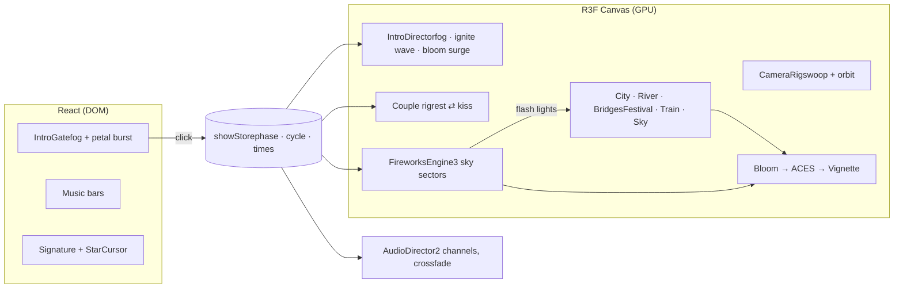
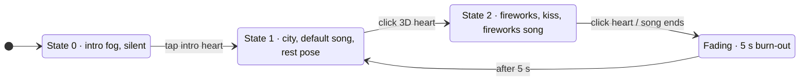

Field notes

1. [The one big idea](#thesis)
2. [Stack & architecture](#stack)
3. [The vibe recipe](#vibe)
4. [The intro sequence](#intro)
5. [The couple](#couple)
6. [Fireworks engine](#fireworks)
7. [The city](#city)
8. [Festival crowd](#crowd)
9. [River & bridges](#river)
10. [Sky, moon, mountains](#sky)
11. [Train & easter egg](#details)
12. [UI layer & audio](#ui)
13. [Performance lessons](#perf)
14. [Start your own](#start)

How it was built · React Three Fiber · GLSL

# Rooftop Fireworks Field Notes

Every visual part of the anime night-city experience, what it is made of, and the maths that gives it its glow. Written as a starting point for building your own.

1.4 M firework particles ≈5,300 walkers ≈6,000 buildings ≈15 city draw calls

The couple on the roof ridge under a sky full of violet and white fireworks, with a giant firework heart

01

## The one big idea: everything is a function of time

Nothing that moves in this scene is simulated step by step on the CPU. Each moving thing is written **once**, with the numbers that describe it (where it started, how fast, when it was born), and the GPU evaluates a formula of time every frame to find out where it is now.

That single decision is why it can draw 1.4 million firework particles, thousands of walking people, petals, fireflies, a steaming train and a reflective river at the same time in a browser.

The pattern used everywherevertex shader

```
// written once, on the CPU, when something is born
attributes = { p0, v0, birthTime, life, seed, … }

// every frame, on the GPU, for every vertex
age      = uTime − birthTime
position = f(p0, v0, age)          // closed-form physics, a loop, an orbit…
alpha    = envelope(age / life)    // fade in, burn, fade out
if (age < 0 || age > life) → discard  // not born yet / already dead: costs ~nothing
```

Keep this pattern in mind. The fireworks, the crowd, the petals, the fireflies, the train's steam and the shockwave are all variations of it.

02

## Stack & architecture

| Layer | Tool | What it does here |
| --- | --- | --- |
| Build | Vite + React 19 | Dev server with hot reload; React renders the overlays (intro, music bars, signature, cursor trail). |
| 3D | three.js via React Three Fiber | The scene graph is JSX. `useFrame(cb, priority)` runs code every frame, in priority order. |
| Helpers | @react-three/drei | OrbitControls, `useGLTF` for models, `PerformanceMonitor`, Sparkles. |
| Post FX | @react-three/postprocessing | Bloom, ACES tone mapping, vignette, screen-space shockwave. |
| Shaders | GLSL in `ShaderMaterial` | Fireworks, city, sky, water, crowd, petals, fireflies, mountains. |
| Audio | YouTube IFrame API + Web Audio | Two music channels with crossfades; the fireworks song starts at 0:25. |
| State | `useSyncExternalStore` | A 20-line global store read by React and by per-frame 3D code. |





- `src/config.js`All the knobs: timing, music, models, camera, intro.
- `src/fireworks/`Particle engine, shaders, shell recipes, show program, physics.
- `src/scene/environment/`City, river, bridges, crowd, train, sky, petals, fireflies.
- `src/scene/characters/`Pose rig, Tanjiro & Kanao placeholders, wind, outlines, glTF slot.
- `src/scene/shared/`Uniforms and GLSL snippets every shader shares (fog, flash lights, ignite, shock).

03

## The vibe recipe

The beauty is mostly **lighting contrast**, not polygon detail. Five ingredients do almost all the work.

### 1 · A cold world with warm lights palette

Everything ambient is deep indigo and violet. Every light source is warm orange. The fireworks then add the complementary neo colours on top. Values marked HDR are brighter than white on purpose.

**#170f2c**Fog & horizon haze

**zenith**Sky top, rgb(0.004, 0.006, 0.02)

**window / lantern**Warm light, up to 3.4× white (HDR)

**violet**Neo firework, rgb(0.55, 0.15, 1)

**magenta**Neo firework, rgb(1, 0.1, 0.78)

**electric**Neo firework, rgb(0.25, 0.7, 1)

### 2 · HDR, then Bloom, then ACES post-processing

The scene renders into a half-float buffer, so a lantern can be 3 and a firework core 9. Bloom only picks up pixels above `luminanceThreshold = 1.0`, so only real light sources glow. It blurs them across several mip levels and adds them back. ACES Filmic tone mapping then rolls those huge values down to screen range with a film-like shoulder instead of clipping.

Post chainsrc/scene/Effects.jsx

```
scene (HDR, linear) → Bloom(threshold 1.0, intensity 2.2, radius 0.8, mipmap blur)
                    → ACES Filmic tone mapping
                    → Vignette(offset 0.22, darkness 0.72)  → sRGB screen
```

### 3 · Exponential fog for depth FogExp2

Distance fades into purple haze, which separates near, middle and far layers. Every custom shader uses the same formula as three.js so they blend perfectly.

Fogshared/glsl.js · applyFog()

```
f      = 1 − exp( −(density · distance)² )      density = 0.0021
colour = mix(surface, fogColour, f)
```

**Fog factor vs distance.** The roof (0 m) is clear, the river (\~170 m) is 12% fogged, the mountains (\~1 km) are almost pure haze.

### 4 · Vignette & composition

Darkened corners pull the eye to the couple. The default camera sits just above the ridge and looks slightly *up*, so the couple fills the lower third and the sky the rest.

### 5 · Neo fireworks against an orange city

Violet, magenta, deep and electric blue and white sit opposite orange on the colour wheel. That complementary contrast is what makes the sky "pop" against the city.

04

## The intro sequence

The page opens on a single heart in drifting midnight fog. One tap unlocks audio (browsers require a gesture) and triggers four effects that run together for about five seconds.

Intro: glowing heart in purple fog

**0.0 s** · State 0. CSS fog layers drift slowly.

The heart bursting into glowing cherry blossom petals

**0.5 s** · The heart bursts into 170 glowing sakura petals.

Camera high above the city as lanterns ignite outward

**2 s** · Camera swoops in while lanterns ignite in a wave.

Settled view of the couple on the roof under the night sky

**5 s** · Settled: State 1, default song playing.

### Petal burst 2D canvas

Each petalui/IntroGate.jsx

```
radius(t) = r0 + (v / 1.6) · (1 − e^(−1.6 t)) · (1 + 0.5 t)   // fast burst, then glide
angle(t)  = a0 + spin · (1 − e^(−1.1 t))                       // swirl that settles
scale(t)  = e^(grow · t)                                        // grows → rushes at you
drawn with globalCompositeOperation = 'lighter' + shadowBlur glow
```

### Camera swoop quadratic Bézier

Pathscene/CameraRig.jsx

```
k = easeInOutCubic(t / 4.8 s)
P = (1−k)²·P0 + 2(1−k)k·P1 + k²·P2     P0 = sky (−40, 340, 260), P2 = resting camera
P1 = far & low over the city           → it dives across the rooftops, then rises
lookAt = lerp(cityCentre, coupleTarget, ease(k·1.15))
```

### Lantern ignition wave shared GLSL

Every warm light in every shader is multiplied by `igniteAt(xz)`. A radius `R` grows from the centre; points inside are lit, and a gaussian ring gives the bright leading edge.

Igniteshared/glsl.js · igniteAt()

```
lit  = 1 − smoothstep(R − 40, R, d)              d = distance from the tower
edge = exp( −((R − 18 − d) / 16)² )
glow = lit · (1 + 0.9 · edge)
R(t) = 30 + 760·u²,  u = (t − 0.5) / 3.6         // u² → accelerates outward
```

At the same time the 3D fog density eases from 0.018 to 0.0021 (the fog "rolls back"), and the bloom intensity surges by +3.2 and settles, which gives the dreamlike flash of the reveal.

**easeInOutCubic.** Used by the swoop and the kiss: slow start, fast middle, gentle landing. No jump cuts.

**Ignition across the city** at three moments. The bump is the bright wave front.

05

## The couple

The placeholders are styled after Tanjiro (green and black checkered haori over the dark corps uniform, hanafuda earrings) and Kanao (white capelet blushing pink at the hem, pleated skirt, white stockings, side ponytail with a glowing butterfly clip). They are built from capsules and cylinders driven by a tiny pose rig, so you can replace them with your own `.glb` later.

Front view: he hugs her from behind on the roof

**Rest pose.** He holds her waist from behind. Note the ink outlines.

Side view of the couple showing the capelet and checkered haori

**Side.** Canvas-generated checker and capelet textures.

The kiss: she turns and reaches up to his cheek as golden embers fall

**Kiss pose**, held for the whole show, under a golden willow.

### The pose rig lerp + slerp

A pose is just a dictionary of joint positions (pelvis, chest, head, elbows, hands, knees…). Two poses exist: rest and kiss. Every frame, one blend value `w` mixes them, and every limb re-solves itself from the joints.

Blendcharacters/rig.jsx · kissState.js

```
k  → moves toward 1 (show) or 0 (rest) at 1/2.2 s or 1/4.5 s
w  = easeInOutCubic(k)
joint      = lerp(rest[j], kiss[j], w)
headRot    = slerp( lookAt(head → restGaze), lookAt(head → kissGaze), w )

// a limb between joints a and b:
mesh.position   = (a + b) / 2
mesh.quaternion = setFromUnitVectors( up, normalize(b − a) )
mesh.scale.y    = |b − a| / restLength
```

### Wind vertex shader injection

The breeze is injected into the built-in materials with `onBeforeCompile`. A height mask keeps shoulders still and lets hems, sleeves and the ponytail move.

Swaycharacters/wind.js

```
mask   = clamp((pivotY − worldY) / range, 0, 1)²
w      = 0.6·sin(2.1t + 6y + 3x) + 0.4·sin(3.7t + 5z)
gust   = 0.65 + 0.35·sin(0.7t)·sin(0.23t + 1)
offset = windDir · (0.5 + 0.6w) · gust · amp · mask
local += inverse(mat3(modelMatrix)) · offset      // world offset → local space
```

### Anime ink outlines inverted hull

Each part is drawn twice: once normally, and once slightly inflated with only its back faces rendered, in dark ink. The bigger back-face shell peeks out around the silhouette as a clean line. The ink copy shares the wind code, so outlines move with the cloth.

- `config.js → MODELS`Swap in your own models; `clips: { rest, kiss }` blends two animations with the same eased weight.
- `characters/poses.js`Joint positions for both poses: edit these to change the hug or the kiss.

06

## The fireworks engine

Rockets rising from the city as the scene dims

**Launch.** Rockets rise; the whole scene dims for a split second.

A giant pink firework heart over the city

**Opening heart.** A heart-curve shell that faces the camera.

Dense violet, white and teal bursts with long streaks

**Canopy.** Long-exposure streaks, layered at many distances.

### Physics in closed form the core trick

Every particle obeys gravity, linear air drag `k` and wind `w`. That differential equation has an exact solution, so no per-frame integration is needed:

Motionfireworks/physics.js · shaders.js

```
dv/dt = g − k·(v − w)                         gravity + drag + wind

vt   = g/k + w                                terminal velocity
v(t) = vt + (v0 − vt)·e^(−k t)
p(t) = p0 + vt·t + (v0 − vt)·(1 − e^(−k t)) / k

// aiming a rocket: burst at point B after exactly T seconds
v0 = (B − p0 − vt·T) · k / (1 − e^(−kT)) + vt
```

**One burst, eight stars.** Drag stops them fast; gravity then droops them into the willow curve.

**A star's life.** Slow ignition (0.16 s), long burn, sputter at the end. The pink curve is white-hot tint.

### What one burst contains

- **Stars** fly out along a *Fibonacci sphere*, the most even way to spread points on a sphere (no clumping at the poles).
- **Tails** are copies of the same star born a few milliseconds later. Same path, delayed, so they trail like a comet.
- **Embers** are spawned where the star *was*: the CPU samples `p(t)` along the path, and each sample becomes a slowly falling twinkle. That's the lingering willow and kamuro curtain.
- **Strobes** blink with `step(0.6, fract(age·freq + seed))`: crackle glitter.
- **Smoke** puffs use normal blending, and they're lit by their own burst and by later bursts nearby.

Shapesfireworks/shells.js

```
// Fibonacci sphere, n stars
y = 1 − (i + 0.5)·2/n     r = √(1 − y²)     φ = i·π(3 − √5)   golden angle
dir = (cos φ·r, y, sin φ·r)

// Heart curve (in a plane facing the camera)
x = 16·sin³t
y = 13·cos t − 5·cos 2t − 2·cos 3t − cos 4t
```

**Fibonacci sphere** (200 points, seen from the side): even coverage, so bursts look round.

**The heart curve.** Each dot is one star's launch direction.

### Long-exposure streaks motion-blurred point sprites

A plain point sprite is a round dot. To get photographic streaks, each sprite is stretched along its own on-screen velocity and drawn as a capsule inside the sprite square.

Streakshaders.js · spark vertex + fragment

```
head = project(p(t))           tail = project(p(t) − v(t)·0.06 s)   to pixels
seg  = head − tail
size = starSize + |seg|        centre = head − seg/2

// fragment: distance from pixel c to the segment a→b
t    = clamp( dot(c − a, b − a) / |b − a|², 0, 1 )
d    = |c − (a + (b − a)·t)| / coreRadius
glow = exp(−14 d²) + 0.35·exp(−4 d²)·(1 − d²)    core + halo
col  = colour·glow + white·core³·(0.2 + 0.5·hot)  tiny white-hot centre
```

**Inside one sprite.** The square is the GPU point; the glowing capsule runs from the tail (dim) to the head (bright).

### Blending

Sparks use additive blending (`ONE, ONE`): light adds up like real light, which is why overlapping bursts glow. The catch: hundreds of stars start at the same point, so their sum can explode into a white orb. The fix was the **0.16 s ignition**: stars spread apart before they get bright.

### The particle buffer ring buffer, 44 bytes

| Attribute | Type | Holds |
| --- | --- | --- |
| position | 3 × float32 | Origin p0 |
| aBirth | 1 × float32 | Birth time (needs full precision) |
| aVel | 3 × float16 | Initial velocity v0 |
| aPhys | 4 × float16 | Life, drag, gravity, intensity |
| aParams | 4 × float16 | Size, flicker frequency, seed, kind |
| aColor / aColor2 | 2 × 4 × uint8 | Colour, colour-change colour + when |

1.4 M slots in a circle: new particles overwrite the oldest. Only the slice written this frame is uploaded (`addUpdateRange`). Dead particles leave the vertex shader on the first line.

### The show program choreography.js

- Repeating \~14 s **movements**: a dense body (≈6–8 shells/s, mirrored pairs, a heart), a crescendo (≈15/s), then a canopy curtain of golden and white kamuro.
- **High canopy:** each shell gets an elevation angle of 9°–34°, and `height = distance · tan(elevation)`. Near and far shells both land in the upper sky, and far ones are scaled up.
- **360°:** three independent programs each own a 120° sector, so the whole sky is always full.
- **Flash lights:** each burst registers a light with power `p·e^(−3.2·age)`. The four strongest are fed to every city, smoke, river and mountain shader.

A peony burst above purple-lit mountains and drifting smoke

**Burst light** on smoke and mountain ridges; layered near and far shells.

Night sky with remaining embers dissolving after the show

**Faded stop.** Leftover embers drop out one by one.

### The faded stop seed-based dissolve

Disintegrationshaders.js

```
p        = clamp(timeSinceStop / 5 s, 0, 1)
dissolve = 1.15 · p^1.8
keep     = smoothstep(dissolve − 0.12, dissolve, seed·0.88 + 0.12)   seed ∈ [0,1) per particle
// particles vanish individually → looks like disintegration, not a fade.
// Smoke erodes through its noise texture the same way.
```

- `shells.js → SPEED, SIZE, BRIGHT, COUNT`Burst radius, sprite size, brightness, stars per shell.
- `shaders.js → smoothstep(0, 0.16, age)`Ignition time: higher means softer burst openings.
- `FireworksEngine.js → SECTORS, SPARK_CAPACITY`Sky coverage and particle budget.

07

## The city

Aerial view of tiled roofs, glowing shoji windows and lantern-lined streets

**Taisho-era blocks:** hip roofs, shoji windows, lantern streets, the viaduct.

The gabled roof the couple stands on, with a gold ornament

**The couple's roof:** concave gable, gold shachihoko, eave lanterns.

### Procedural layout cityLayout.js

- A grid of 30 m blocks with 6 m streets (wider avenues every 4th line). Each block is split into 2–4 × 2–3 lots with jitter.
- Floors are random, with taller buildings near the centre: `p = 0.12·exp(−d²/2σ²)`.
- A seeded random generator (`mulberry32`) makes the city identical on every load.
- The river follows `z = −(150 + 40 sin(x/120) + 14 sin(x/45 + 1.3))`. Two sines make a natural meander, and every system (buildings, bridges, crowd, water shader) uses the same function.

### Instancing

About 6,000 buildings are a single `InstancedMesh` of a 1 × 1 × 1 box. Each instance's matrix scales it to its footprint and height. Roofs, lanterns and signs work the same way. The whole city is about 15 draw calls.

### Windows without textures fragment shader

WindowscityMaterials.js · building shader

```
fy = height / 3.2        floor = ⌊fy⌋      fv = fract(fy)
fx = u / columnWidth     col   = ⌊fx⌋      fu = fract(fx)
window = box(fu, fv)                              rectangle inside each cell
lit    = hash(buildingSeed, floor, col) < litProbability
shoji  = 1 − 0.5·max( step(0.88, fract(fu·5)), step(0.85, fract(fv·3)) )

// anti-aliasing: when a window is smaller than ~3 px, use its average glow
far      = smoothstep(0.25, 0.6, max(fwidth(fy), fwidth(fx)))
emissive = mix(pattern, averageGlow, far)
```

### Japanese hip roofs custom geometry

Each roof is a ring of vertices rising from eave to ridge. Height follows `y = s^1.7` (steep at the ridge, flat at the eaves: the concave Japanese line), and the corners curl up.

Roof profileenvironment/geometry.js

```
s ∈ [0, 1] (eave → ridge),   u ∈ [0, 1] along each side
footprint scale = 1 + (topRatio − 1)·s
y    = s^1.7
lift = 0.22 · |2u − 1|^6 · (1 − s)²     corners only, strongest at the eave
```

**Roof cross-section.** Dashed: straight pyramid. Solid: the concave `s^1.7` line with the upturned corner.

### Lit by the fireworks

Flash lightshared/glsl.js · flashLight()

```
for each of the 4 strongest bursts:
  L   = burstPos − p
  att = 1 / (1 + |L|² / R²)                       softened inverse-square
  light += colour · att · (0.25 + 0.75·max(N·L̂, 0))  + Lambert
```

08

## The festival crowd

A lantern-lined street with groups of silhouettes walking

**A festival street.** Groups of 1–4 walk both ways; some carry lanterns.

About 5,300 walkers spread over most of the lit street grid, busiest below the tower and thinning with distance. Each walker is one instance holding 12 numbers: lane, start offset, signed speed, side offset, height and tint. The vertex shader does everything else. The whole crowd plus lanterns is **two draw calls**.

Walker motionenvironment/Festival.jsx

```
s    = mod(start + t·speed, laneLength)                 loops along the street
fade = smoothstep(0, 4, s) · smoothstep(0, 4, len − s)  appear / vanish at the ends
pos  = laneStart + s along the lane, + side offset across it
y   += |sin(t·|speed|·3.2 + phase)| · 0.04               step bob
bridges: y += 1.1 + rise·sin(π·s/len)                   follow the arch
```

The streets glow in the ground shader using the same grid maths, so walkers, lanterns and light always line up. Silhouettes are kept dark with a warm rim, so they read against the bright street.

09

## River & bridges

Arched wooden bridge over the river with reflections of the lights

**Real reflections** of buildings, lanterns and the bridge, rippled by the current.

The glowing Pillu sign on a teahouse roof with moonlight glittering on the river

**Moon glitter** on the water, behind the Pillu sign.

### Planar reflection

three.js `Reflector` mirrors the camera across the water plane and renders the whole scene into a half-float texture, with an oblique clip plane cutting off everything below the surface. A custom water shader then reads that texture.

Waterenvironment/River.jsx

```
// ripples in river space: q.x = downstream, q.y = across
h(q, t) = Σ aᵢ · noise(q · fᵢ − t · speedᵢ)          4 octaves, scrolling
∂h/∂x ≈ (h(q + ε) − h(q)) / ε                         finite differences
N  = normalize(−∂h/∂x · s, 1, −∂h/∂z · s)

reflection = texture2DProj(mirror, uv + N.xz · 0.045)  ripples bend reflections
F = 0.02 + 0.98 · (1 − N·V)^5                          Schlick Fresnel
colour = mix(deepWater, reflection, 0.38 + 0.85·F)
glint  = pow(dot(reflect(−V, N), moonDir), 700)
```

**Fresnel.** Looking straight down, water reflects \~2%. At the grazing angles you see from the roof it becomes a mirror.

### The bridges

Three arched wooden bridges. The deck is a custom strip with plank UVs running across it, and its height is `G + 1.1 + 4.2·sin(πu)`. Posts, piers and cross-bracing are instanced beams placed between two points. There are bronze giboshi finials, stone tōrō lanterns, and walkers whose height follows the same arch.

10

## Sky, moon, mountains

Full moon behind long streaky clouds above dark mountains

**One shader on a sphere:** gradient, moon, halo and clouds. Stars are a separate point layer.

Skyenvironment/Sky.jsx

```
h    = viewDir.y                                       elevation
sky  = mix(horizon, mid, smoothstep(0, 0.25, h)) → zenith
sky += cityGlow · exp(−18·max(h, 0))                   orange-purple horizon

ang  = acos(dot(viewDir, moonDir))                     angular distance
disc = 1 − smoothstep(0.96R, R, ang)          halo = 0.22·exp(−14·ang)

// clouds: project the view onto a plane, then fractal noise
p     = viewDir.xz / (h + 0.18)
cloud = smoothstep(0.52, 0.8, fbm(p · (0.9, 2.6) + wind·t))
fbm(p) = Σ 0.5ⁱ · noise(2.03ⁱ · p)                      5 octaves
```

**Mountains** are two rings of vertices whose height is a sum of sines (broad shapes plus small craggy detail). They're shaded misty at the base, and their ridgelines pick up the firework flash colour with `pow(edge, 7)`.

11

## Train & the easter egg

A dark steam train with glowing yellow windows on a brick viaduct

**The train** on its brick viaduct, windows flickering.

Trainenvironment/Train.jsx

```
headX(t) = −560 + mod(t · 15 m/s, 1120)          wraps far outside the fog
// steam puff i: emitted at te = t − age from wherever the chimney was
age  = mod(t + i·(6 s / 90), 6 s)
pos  = (headX(t − age) + 4.6, deck + 5.2 + 2.2·age, railZ) + wind·age
```

Because the train's position is a pure function of time, the GPU can rebuild the entire steam trail every frame without storing any history.

The **Pillu** sign (seen in chapter 09) is a canvas texture: a warm radial gradient, a brush-script word in sumi-dark ink and a red hanko seal, on a lantern-lit teahouse roof. It's dark until the intro's ignition wave reaches it.

12

## UI layer & audio

Star cursor sparkles, the Kiro signature and the music bars in the corner

**Overlay:** falling-star cursor sparkles, the signature, the five music bars.

- **Star cursor:** 40 recycled DOM sparkles animated with the Web Animations API (no React re-renders), fading and shrinking over about 0.6 s.
- **Music bars:** real spectrum data from an `AnalyserNode` for local files. For YouTube, which can't be analysed cross-origin, they're synthesised from layered sines scaled by the real playback volume.
- **Heart click:** a ring expands at 14 m/s and pushes petals and fireflies away, plus a screen-space ripple.

Shockwave pushshared/glsl.js · shockOffset()

```
reached = smoothstep(dist − 1.5, dist, age · 14)
push    = dir · 2.6·e^(−dist/9) · (1 − e^(−5·(age − dist/14))) · e^(−0.7·age) · reached
```

Crossfadeaudio/AudioDirector.js

```
every 40 ms:  gain → target at rate (1 / crossfadeSeconds)
volume = gain · channelVolume · (muted ? 0 : 1)
fireworks track: pre-buffered muted at 0:25, then seekTo(25) + play on click
```

13

## Performance lessons

1. **Fill-rate kills before vertex count.** The browser froze when huge smoke puffs (≈500 px each) and large sprites overlapped. Capping sprite size fixed it.
2. **Additive overlap makes white blobs.** Delay brightness until particles have spread out.
3. **Maths, not simulation.** Closed-form motion and `mod()` loops cost nothing on the CPU per frame.
4. **Instance everything that repeats.** Buildings, roofs, lanterns, walkers, bridge posts.
5. **Pack your attributes.** Half floats and 8-bit colours halve particle memory.
6. **Adaptive resolution.** `PerformanceMonitor` drops the pixel ratio before frames drop.
7. **Anti-alias procedural patterns.** `fwidth()` tells you when a pattern is smaller than a pixel.

14

## Start your own

1. **Scene basics.** Learn three.js (scene, camera, mesh, material), then React Three Fiber (`<Canvas>`, `useFrame`).
2. **Your first shader.** A gradient sky in a `ShaderMaterial`. Master `mix`, `smoothstep`, `fract` and `floor`: they do most of the work in this project.
3. **The HDR pipeline, early.** Output values above 1, add Bloom + ACES. Most of the "vibe" lives here.
4. **One GPU particle system** with closed-form motion. That one skill gives you fireworks, petals, crowds and steam.
5. **Atmosphere before detail.** Fog, a cold/warm palette and a vignette. Then add buildings, characters and the rest.

**Read next.** [The Book of Shaders](https://thebookofshaders.com) for noise and patterns · [Inigo Quilez's articles](https://iquilezles.org/articles/) for smooth maths · [Three.js Journey](https://threejs-journey.com) for a structured course · [React Three Fiber docs](https://r3f.docs.pmnd.rs).

Every file in the project is commented with what it does and why. Good ones to read first: `src/fireworks/physics.js`, `src/fireworks/shaders.js`, `src/scene/environment/cityMaterials.js`.

Screenshots captured from the running app. Plots are drawn from the same equations the app uses.